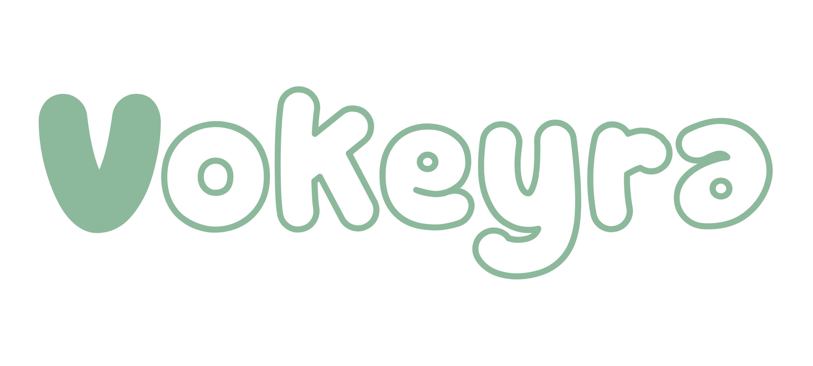

  

  Локальная и приватная голосовая диктовка для Windows и Linux.

  <a href="README.md">English</a> · <strong>Русский</strong>

# Vokeyra

Vokeyra — бесплатное приложение с открытым исходным кодом для преобразования речи в текст на Windows и Linux. Нажмите горячую клавишу, произнесите текст, и Vokeyra вставит результат в приложение, которым вы пользуетесь.

Распознавание выполняется локально на компьютере. В Vokeyra нет аккаунтов, облачной транскрипции, телеметрии, подписок и платных API. Интернет нужен для загрузок и проверки обновлений.

## Скачивание и установка

1. Откройте страницу [последнего выпуска](../../releases/latest).
2. Скачайте установщик для Windows в формате `.exe` или `.msi`.
3. Запустите установщик, а затем Vokeyra.
4. Разрешите доступ к микрофону, когда Windows запросит его.

Для интерфейса используется Microsoft Edge WebView2. Если этот системный компонент отсутствует, установщик скачает его автоматически.

Установщик Windows пока не имеет цифровой подписи. Windows SmartScreen может показать предупреждение.

EXE устанавливается для текущего пользователя, MSI — для всех пользователей с правами администратора. При обновлении используйте тот же формат.

Для Linux x64 скачайте `.deb` для Ubuntu/Debian, `.rpm` для Fedora или `.AppImage` для других дистрибутивов. Поддержка Linux экспериментальная; требования и ограничения указаны в [инструкции для Linux](docs/LINUX.md).

При переходе с 0.1.1 скачайте и установите 0.3.0 вручную. Последующие обновления можно скачивать и устанавливать из приложения.

## Первая диктовка

1. Откройте **Модели** и выберите модель. Для большинства пользователей хорошей отправной точкой будет **Whisper Base**, а для русского языка рекомендуется **GigaAM v3 E2E RNNT**.
2. Дождитесь скачивания и проверки файлов. Модель применится автоматически.
3. Откройте **Главное** и проверьте язык, микрофон и горячую клавишу. По умолчанию используется **Ctrl + Shift + Space**.
4. Поставьте курсор в любое текстовое поле, нажмите горячую клавишу и говорите. Нажмите её ещё раз, чтобы завершить запись. При желании в разделе «Главное» можно включить режим удержания клавиши.
5. Vokeyra распознает запись и вставит текст в приложение, которое было активно до начала записи.

Глобальная горячая клавиша работает и при свёрнутом окне Vokeyra. Запись также можно запустить вручную из раздела **История**.

## Возможности

- Полностью локальное распознавание речи на процессоре.
- 19 моделей для многоязычной диктовки, русского, английского, европейских, восточноазиатских и нескольких центральноазиатских языков.
- Настраиваемая глобальная горячая клавиша и режимы нажатия или удержания.
- Автоматическая вставка текста, управление буфером обмена и автоматическая отправка.
- Выбор микрофона и канала, звуковые сигналы и отключение системного звука во время записи.
- Локальная история с прослушиванием, избранным, копированием, удалением и повторным распознаванием.
- Знаки препинания, удаление слов-паразитов, пользовательский словарь и пробел после результата.
- Автозамены слов и фраз для всех моделей: Настройки → Автозамены слов.
- Русский и английский интерфейс, системный трей, автозапуск и два размера окна.

## Модели

Модели скачиваются только после выбора и не входят в установщик. Размеры загрузок указаны приблизительно.

| Модель | Языки | Загрузка | Для чего подходит |
| --- | ---: | ---: | --- |
| Whisper Tiny Q5_1 | 99+ | 32 МБ | Самый маленький многоязычный вариант |
| Whisper Tiny | 99+ | 78 МБ | Быстрое базовое распознавание |
| Whisper Base Q5_1 | 99+ | 60 МБ | Компактная повседневная диктовка |
| Whisper Base | 99+ | 148 МБ | Лучший универсальный вариант для начала |
| Whisper Small Q5_1 | 99+ | 190 МБ | Повышенная точность при небольшой загрузке |
| Whisper Small | 99+ | 488 МБ | Более точная многоязычная диктовка |
| Whisper Medium Q5_0 | 99+ | 539 МБ | Высокая точность на разных языках |
| Whisper Large v3 Turbo Q5_0 | 99+ | 574 МБ | Высокая точность при разумной скорости |
| Whisper Large v3 Q5_0 | 99+ | 1 081 МБ | Максимальная точность Whisper, но низкая скорость |
| GigaAM v3 E2E CTC | Русский | 225 МБ | Точное распознавание русского языка |
| GigaAM v3 E2E RNNT | Русский | 226 МБ | Быстрая русская диктовка со знаками препинания |
| NVIDIA Parakeet TDT 0.6B v3 | 25 европейских языков | 670 МБ | Точная диктовка на европейских языках |
| Moonshine Tiny English | Английский | 124 МБ | Быстрое и компактное распознавание английского |
| GigaAM Multilingual CTC | RU, KZ, KY, UZ, EN | 225 МБ | Русский и языки Центральной Азии |
| Vosk Small Russian | RU | 27 МБ | Лёгкая модель для русского языка |
| Zipformer GigaSpeech English | EN | 74 МБ | Компактное распознавание английского |
| Moonshine Base English | EN | 287 МБ | Более крупная альтернатива Moonshine Tiny |
| SenseVoice Small | ZH, EN, JA, KO, YUE | 240 МБ | Китайский, кантонский, английский, японский и корейский |
| Distil-Whisper Large v3 | EN | 1 520 МБ | Английская диктовка на основе Whisper Large v3 |

Крупные модели обычно требуют больше оперативной памяти и дольше обрабатывают запись. Можно установить несколько моделей, переключаться между ними и в любой момент удалять ненужные.

Веса SenseVoice распространяются по [FunASR Model License](https://github.com/modelscope/FunASR/blob/main/MODEL_LICENSE). Лицензии остальных моделей указаны в приложении и [уведомлениях о сторонних компонентах](THIRD-PARTY-NOTICES.md).

## Системные требования

| | Требование |
| --- | --- |
| Операционная система | Windows 10/11 x64 или Linux x64 (экспериментально; проверена Ubuntu 22.04 X11) |
| Процессор | 64-битный процессор Intel или AMD |
| Оборудование | Рабочий микрофон; отдельная видеокарта не требуется |
| Интернет | Нужен для скачивания приложения и выбранных моделей |
| Место на диске | Файлы приложения и от 27 МБ до 1,52 ГБ на каждую установленную модель |

Сборок для macOS, ARM и 32-битных систем пока нет. В Linux горячие клавиши и автоматическая вставка требуют X11. Для Wayland предусмотрены запись кнопкой и ручная вставка из буфера; проверка на нативном рабочем столе Wayland ещё не проведена. Отключение системного звука во время записи доступно только в Windows.

## Приватность и локальные данные

Аудио и текст обрабатываются на компьютере. Vokeyra не отправляет записи или результаты распознавания на сервер приложения и не собирает телеметрию. Файлы моделей скачиваются из источников, указанных во встроенном каталоге.

Настройки, установленные модели, записи и история хранятся в локальном каталоге данных Vokeyra. Каталог данных и папку с записями можно открыть из приложения. Записи истории и ненужные модели можно удалить в любой момент.

## Текущие ограничения

- Распознавание пока работает на процессоре; время обработки зависит от модели и компьютера.
- Установщик Windows пока не имеет цифровой подписи.
- Начиная с 0.3.0 кнопка проверки обновлений скачивает и устанавливает обновления с проверкой подписи. Эта подпись отличается от цифровой подписи установщика Windows.

## Лицензия и благодарности

Исходный код Vokeyra распространяется по [лицензии MIT](LICENSE). У речевых движков и файлов моделей есть собственные лицензии. Авторы, закреплённые источники моделей, сведения о конвертации и ссылки на лицензии перечислены в [уведомлениях о сторонних компонентах](THIRD-PARTY-NOTICES.md).

[Политика конфиденциальности](PRIVACY.md) · [Code signing policy — политика подписи](docs/CODE_SIGNING.md)

Vokeyra использует или поддерживает разработки [whisper.cpp](https://github.com/ggml-org/whisper.cpp), [OpenAI Whisper](https://github.com/openai/whisper), [GigaAM](https://github.com/salute-developers/GigaAM), [NVIDIA Parakeet](https://huggingface.co/nvidia/parakeet-tdt-0.6b-v3), [Moonshine](https://github.com/moonshine-ai/moonshine), [sherpa-onnx](https://github.com/k2-fsa/sherpa-onnx) и [ONNX Runtime](https://github.com/microsoft/onnxruntime).
