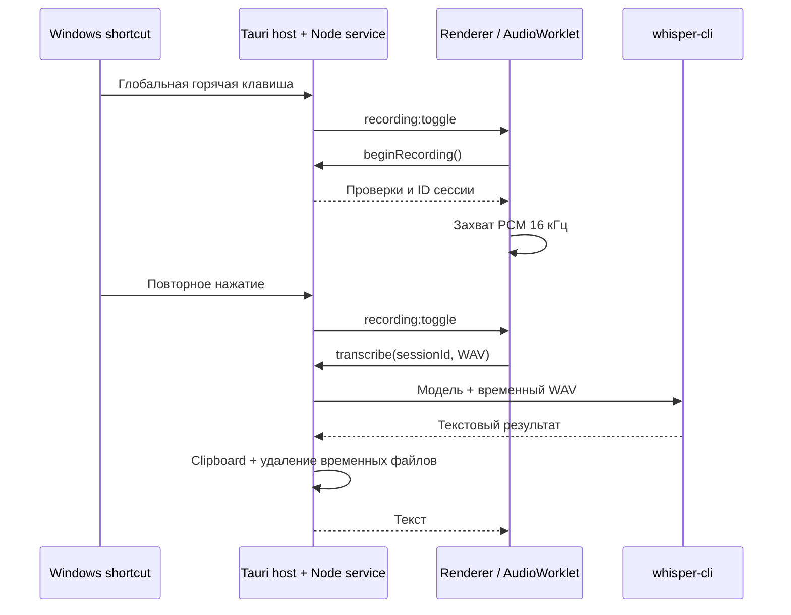

# Архитектура Vokeyra

Начиная с 0.3.0 оболочка использует Tauri 2 и системный WebView. Подробности сборки и подписи: [Tauri desktop](TAURI-MIGRATION.md).

## Границы модулей

```text
src/
  shared/
    contracts.ts       # Типы каталога, настроек, IPC, прогресса
    wav.ts             # Контракт PCM16 mono 16 kHz
    hotkey.ts          # Валидация одиночных клавиш и сочетаний
  renderer/
    index.html         # Пять боковых вкладок, без UI-фреймворка
    overlay.html       # Индикатор записи для Windows (WebView)
    overlay.ts
    overlay.css
    main.ts            # UI-состояние и вызовы ограниченного API
    recorder.ts        # Захват микрофона и жизненный цикл записи
    recorder.worklet.js
    style.css
  main/
    service.ts         # Каталог, история, модели и сессии записи
    host.ts            # Закрытый протокол с Rust через stdin/stdout
    catalog.ts         # Runtime-валидация встроенного JSON
    storage.ts         # Запись JSON через временный файл + rename
    download.ts        # Streaming download, лимиты, SHA-256
    models.ts          # Каталог, версии файлов, установка/удаление
    history.ts         # История, избранное и постоянное хранение WAV
    tauri-overlay.ts   # Состояние индикатора и команды Rust-окну
    engines/
      types.ts         # SpeechEngine и EngineRegistry
      whisper.ts       # Запуск встроенного whisper-cli без shell
    platform/
      desktop.ts       # Системная горячая клавиша и clipboard
resources/models.json
src-tauri/             # Окна, системные команды, трей и подписанные обновления
  src/overlay.rs       # Нативный GTK/Cairo индикатор: layer-shell + fallback-окно
scripts/               # Сборка Tauri, dev runner, WebView smoke
tests/                 # Поведение каталога, загрузок и аудио
```

## Поток диктовки



Основной процесс резервирует сессию до запроса разрешения микрофона. Сессия привязана к выбранной модели; во время записи/распознавания настройки и операции установки/удаления блокируются. Повторный вызов распознавания для одной сессии отклоняется. Отмена прерывает дочерний процесс; новый сеанс не получает доступ к занятой модели до его завершения.

Renderer управляет состояниями `idle → starting → recording → transcribing → idle`; номер поколения защищает от запоздалых результатов после отмены. Лимит записи — 5 минут, распознавания — 15 минут. Горячая клавиша работает без фокуса, пока процесс приложения жив.

Основное окно имеет размер 780 × 600. Индикатор — отдельное прозрачное окно 248 × 58, без рамки и кнопки в панели задач, `focusable: false`, без получения фокуса, always-on-top. Его позиция выбирается в рабочей области монитора под курсором. RMS аудиоблоков передаётся из AudioWorklet через renderer/main около 8 раз в секунду. Команды индикатора ограничены Rust-проверкой метки окна: прочитать состояние и отменить запись; доступа к настройкам, файлам и микрофону у него нет.

При назначении горячей клавиши основное окно временно снимает регистрацию прежней клавиши, чтобы она не запускала диктовку. Новая клавиша проверяется, регистрируется в ОС и сохраняется. Конфликт оставляет режим ввода открытым для повторной попытки. Отмена, потеря фокуса и таймер 30 секунд восстанавливают прежнюю регистрацию. Допускаются одиночные клавиши и сочетания; одиночные модификаторы исключены.

`HistoryStore` хранит метаданные в `history.json`, аудио — в `recordings/<UUID>.wav`. Запись сохраняется перед распознаванием, поэтому после ошибки доступен повтор. Избранное сохраняется в метаданных. Политика истории удаляет незакреплённые записи по выбранному числу или сроку хранения. Временные входные WAV и вывод CLI изолированы в `transcription-tmp` и очищаются отдельно. IPC отдаёт аудио только по ID существующей записи; renderer воспроизводит Blob URL и освобождает его при смене записи или вкладки.

## Движки и переносимость

`SpeechEngine.transcribe()` получает пути к WAV и модели, путь встроенного runtime, язык, выходной префикс и `AbortSignal`. Возвращает текст. Реестр разрешает только явно зарегистрированные адаптеры. JSON не задаёт команды или аргументы исполняемого файла.

Адаптер запускает входящий в приложение whisper.cpp через `spawn(executable, args, { shell: false, windowsHide: true })`. CPU-режим выбран для простого старта; `-ng` отключает GPU. Нужная CPU DLL выбирается самим ggml. Движок загружается заново для каждой записи, поэтому короткие диктовки могут иметь заметную задержку.

Для совместимости с ANSI-аргументами Windows-сборок CLI запускается из папки временной записи; пути модели/WAV/результата передаются относительно неё. Поэтому кириллица в имени пользователя или папке проекта не попадает в аргументы `fopen`. Сам исполняемый файл и рабочая папка передаются через Unicode API Windows.

GigaAM CTC работает через ONNX Runtime, а GigaAM RNNT, Parakeet TDT и Moonshine — через sherpa-onnx. Все движки получают тот же входной WAV, запускаются в изолированных процессах Node.js и не настраиваются пользователем вручную.

Системная интеграция вынесена в `DesktopIntegration`. В Linux используются отдельные адаптеры для X11 и Wayland: глобальная клавиша X11 регистрируется Tauri, в Wayland — через привязки композитора или swhkd; вставка идёт через xdotool, wtype, ydotool или dotool. `LinuxNative` проверяет не только наличие исполняемых файлов, но и демон и сокет ydotool, доступ к `/dev/uinput` и подключение swhkd, а `DesktopCapabilities.linux` передаёт в интерфейс причины и рекомендуемые действия. На Linux запись микрофона выполняет служба через `parec` (PulseAudio/PipeWire), потому что WebKitGTK приостанавливает `getUserMedia` у скрытого окна; Windows продолжает записывать через WebView. Индикатор записи в Linux — нативное окно GTK/Cairo (без WebView). В native Wayland оно по возможности становится layer-surface через runtime-загружаемый `gtk-layer-shell`; при отсутствии протокола остаётся компактным плавающим окном с фиксированным заголовком и transient-родителем. Windows продолжает использовать WebView-индикатор. Остальные различия разрешений macOS, Wayland/X11, архитектур CPU и пакетов runtime потребуют платформенной работы; macOS не тестировалась.

## Установка и обновление модели

1. Валидировать схему версии 2, уникальный безопасный ID, относительные пути, HTTPS, полный SHA-256 и точный размер каждого артефакта. Старую схему версии 1 нормализовать в однофайловый пакет.
2. Скачать все файлы в уникальную staging-папку, считать SHA-256 по мере записи и публиковать общий прогресс пакета не чаще 10 раз/секунду.
3. Прервать установку при отмене, ошибке сети, несовпадении размера или SHA-256. Удалить staging-папку целиком.
4. Обычные файлы разместить по объявленным относительным путям; проверенный `tar.gz` распаковать без абсолютных путей, `..`, ссылок и специальных файлов.
5. Проверить объявленный `entrypoint`, записать `installed.json` и транзакционно заменить папку модели. При сбое вернуть резервную копию предыдущей установки.
6. После успешной установки сделать модель выбранной; для одноязычной модели установить её язык, для многоязычной сохранить поддерживаемый выбор либо включить автоопределение.

Набор хешей, путей и форматов определяет доступность обновления; изменение только описания не вызывает повторную загрузку идентичного пакета. Папки `.staging` и `.backup` обеспечивают восстановление после аварии до, во время или сразу после замены модели.

Установленные метаданные сохраняются отдельно от встроенного каталога. Обновление приложения заменяет рабочую копию каталога, не удаляя уже установленные файлы. На старте проверяется размер установленного файла; полный SHA-256 проверяется при каждой установке, а не при каждом запуске.

## Настройки звука и Windows

`Preferences` и `validatePreferences` задают валидируемые настройки с безопасными значениями по умолчанию для старых файлов. IPC принимает частичное обновление: изменение языка не сбрасывает микрофон и режим записи. Выбор устройств основан на `enumerateDevices`; точный `deviceId` передаётся в `getUserMedia`. AudioWorklet усредняет каналы или выбирает один перед кодированием mono WAV.

`DesktopIntegration` скрывает платформенные детали. Windows-адаптер запускает собственный EXE Vokeyra в режиме `--desktop-worker` с протоколом через stdin/stdout; реализация находится в `src-tauri/src/desktop_worker.rs`. Отдельный .NET-модуль не собирается и не включается в установщик. `GetAsyncKeyState` наблюдает только клавиши назначенного сочетания после глобального нажатия; обычный ввод не перехватывается и не сохраняется. Повторные keydown игнорируются до отпускания. Если клавишу отпустили до готовности микрофона, запуск отменяется.

Модуль использует Windows Core Audio (`IAudioEndpointVolume`) и хранит исходные mute-состояния активных выходов. Он восстанавливает их по команде, при EOF канала или завершении родителя. Сигнал начала проигрывается до отключения звука и захвата микрофона; сигнал конца — после остановки микрофона и восстановления звука. Мелодии генерируются в renderer, выводятся через `HTMLAudioElement.setSinkId` и не меняют системную громкость. Для macOS/Linux нужны реализации этих операций в другом адаптере.

`node scripts/test-native.mjs` проверяет реальное отпускание F24, игнорирование повторного нажатия, mute/restore и восстановление после закрытия канала. Проверка кратковременно меняет системный mute и возвращает прежнее состояние. `tests/recorder-worklet.test.ts` проверяет усреднение и раздельный выбор каналов.

Проверка интерфейса использует тестовый микрофон WebView2. Она не меняет политики безопасности Windows и не выполняет автовставку в пользовательские приложения.

## Формат каталога

`schemaVersion: 2`, до 200 записей. Каждая запись содержит:

| Поле | Назначение |
| --- | --- |
| `id` | Стабильный ID: латинские строчные буквы, цифры, дефис |
| `engine` | Идентификатор зарегистрированного адаптера |
| `version` | Человекочитаемая версия артефакта |
| `name`, `developer` | Название и авторы модели/конверсии |
| `languages` | Список описаний поддерживаемых языков |
| `speed`, `quality` | Относительные оценки; не обещание времени или WER |
| `license`, `licenseUrl` | Лицензия артефакта и первоисточник |
| `family`, `quantization` | Семейство и вариант весов для группировки и понятного отображения |
| `capabilities` | Потоковый режим, перевод, определение языка и пунктуация |
| `entrypoint` | Относительный путь к главному файлу, который получает адаптер движка |
| `artifacts[]` | Один или несколько файлов пакета; для каждого задаются `filename`, `format`, `sizeBytes`, `url`, `sha256` |

Размеры и SHA-256 получены из LFS-метаданных [официального GGML-репозитория](https://huggingface.co/api/models/ggerganov/whisper.cpp/tree/main). Меняя модель, нужно обновлять ссылку, размер и SHA-256 согласованно. Формат `file` сохраняет файл напрямую, а `tar.gz` после проверки распаковывается в папку модели. `models.json` переносит метаданные и ссылки, но не исполняемый код. Новый адаптер требует выпуска приложения.

## Проверки

`npm test` проверяет обе версии схемы, traversal/небезопасные URL, многофайловую и архивную установку, транзакционное обновление, аудиоконтракт, повреждённые/обрезанные файлы, потоковую отмену, повторную попытку и правила HTTPS-перенаправлений.

`npm run smoke` запускает Tauri с отдельным профилем `.tmp/tauri-ui-*`, подключается к тестовому WebView2 через CDP и проверяет интерфейс, регистрацию клавиши, настройки, неизменность позиции окна и доступ к микрофону. Скриншот: `.tmp/tauri-ui.png`.

`npm run smoke:service` проверяет настоящий сервис и Windows-модуль с изолированными настройками. `node scripts/smoke-engines.mjs` проверяет загрузку ONNX-библиотек и выполняет распознавание тишины установленными моделями, не изменяя пользовательские данные.

## Представление каталога моделей

Вкладка разделяет загруженные модели и доступные для загрузки. Поиск имени, язык и переключатель рекомендаций фильтруют обе группы. Меню языков показывает распространённые языки с их самоназваниями.

В models.json поле languages содержит полный список кодов языков. Необязательные speedScore и qualityScore (1–5) задают сравнительные уровни, а не измеренные проценты или скорость конкретного компьютера. recommended и recommendationReason задают редакционную рекомендацию каталога; рекомендуемые модели располагаются выше остальных доступных для загрузки. Каталог допускает не больше пяти рекомендаций: текущий набор охватывает общий баланс, точный Whisper с разумной скоростью, быструю русскую модель, европейские языки и языки Центральной Азии.

Tiny, Base, Small и Medium используют 99 языков из [официального токенизатора Whisper](https://github.com/openai/whisper/blob/main/whisper/tokenizer.py). Large v3 и Large v3 Turbo поддерживают 100 языков: в этой версии OpenAI добавила отдельный код `yue` для кантонского. Флаги не используются.

## GigaAM v3 E2E CTC

Адаптер gigaam-v3-e2e-ctc запускает изолированный процесс Node.js с onnxruntime-node 1.22.0 (CPU). Выбор EXE и Python не нужны. Каталог использует INT8 ONNX-конверсию istupakov/gigaam-v3-onnx, закреплённую ревизию 322c3b29492673eb7d0b434bfa9dfb8653e34d02, 224893347 байт и SHA-256. Словарь этой ревизии включён в приложение, лицензии поставляются с EXE. При выборе модели язык переключается на русский; Whisper CLI и его CPU DLL также входят в сборку.

Вход: WAV PCM16 mono 16 кГц. Признаки: periodic Hann 320, шаг 160, 64 HTK mel, power spectrum, натуральный логарифм, без центрирования. Параметры: https://huggingface.co/istupakov/gigaam-v3-onnx/blob/main/v3_e2e_ctc.yaml . Выход log_probs декодируется greedy CTC с удалением повторов/blank и заменой SentencePiece пробелов. Записи длиннее 24 секунд разделяются в тихих местах с перекрытием 350 мс; повторы на границах объединяются. Это простая сегментация, не отдельная VAD-модель; качество границ предстоит проверить вручную. Отмена завершает отдельный процесс, лимит распознавания — 15 минут.

## sherpa-onnx: RNNT, Parakeet и Moonshine

Адаптер sherpa-onnx-node 1.13.8 запускает CPU-распознавание в отдельном процессах Node.js. GigaAM v3 E2E RNNT использует 64 mel-признака и русский язык, Parakeet TDT 0.6B v3 — 80 mel-признаков и 25 европейских языков, Moonshine Tiny — английский язык. Модели поставляются отдельными многофайловыми пакетами INT8; Python не нужен. Длинные записи делятся в тихих местах, а отмена завершает процесс.

Меню фильтра языков содержит выбранные распространённые языки с самоназваниями, без поля поиска. Полный список поддержки модели в каталоге не сокращается.
